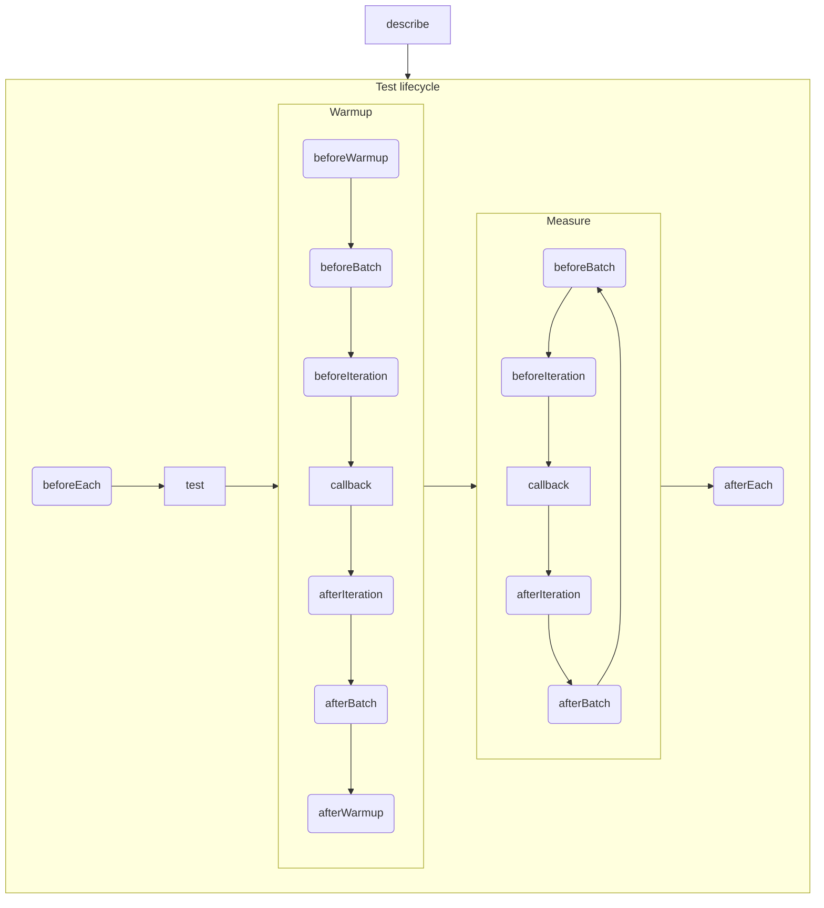

<p align="center">
  <a href="#readme"></a>
</p>

The Node.js performance testing tool with unit-test-like API.

- Runs each test in a separate process;
- Measures execution time using [`performance`](https://developer.mozilla.org/en-US/docs/Web/API/Performance);
- Times loops of calls, so timer resolution doesn't distort results of fast functions;
- Runs tested functions in multiple batches to reduce garbage collection interference, and reports the margin of error
  between batches;
- Warms up tested functions;
- Measures memory consumption using [`v8.getHeapStatistics`](https://nodejs.org/api/v8.html#v8getheapstatistics).

```shell
npm install toofast --save-dev
```

TooFast requires Node.js 22.18+.

🔰&ensp;[**Usage**](#usage)

🚀&ensp;[**Authoring tests**](#authoring-tests)
- [`test`](#test)
- [`describe`](#describe)
- [Lifecycle hooks](#lifecycle-hooks)
- [TypeScript support](#typescript-support)

⚙️&ensp;[**Configuration**](#configuration)
- [Test options](#test-options)
- [Command line arguments](#command-line-arguments)
- [Inline options](#inline-options)

# Usage

Let's write a performance test for a function that computes a factorial.

Create a file `factorial.perf.js`:

```ts
import { describe, test, measure } from 'toofast';

function factorial(x) {
  return x === 0 ? 1 : x * factorial(x - 1);
}

describe('factorial', () => {

  test('of 33', () => {
    measure(() => {
      factorial(33);
    });
  });

  test('of 42', () => {
    measure(() => {
      factorial(42);
    });
  });
});
```

Call `toofast` in the same directory with this file:

```shell
npx toofast
```

The process exits with code 1 if any test has thrown an error.

# Authoring tests

TooFast package exports several callbacks that you can use in test file.

## `test`

The minimum setup that you need in a test file is the `test` callback which encloses a group of measurements. For
example, let's say there's a function `factorial` which performance must be measured. Your whole test could be:

```ts
import { test, measure } from 'toofast';

test('factorial of 33', () => {
  measure(() => {
    factorial(33);
  });
});
```

The `measure` callback starts the performance measurement. It can be invoked multiple times inside a `test` block to
collect a data population from which an average results are derived.

```ts
test('factorial of 33 and 42', () => {

  measure(() => {
    factorial(33);
  });

  measure(() => {
    factorial(42);
  });
});
```

## `describe`

Creates a block that groups together several related tests.

```ts
import { describe, test, measure } from 'toofast';

describe('factorial', () => {

  test('of 42', () => {
    measure(() => {
      factorial(42);
    });
  });
});
```

`describe` blocks can be nested:

```ts
describe('Math', () => {

  describe('factorial', () => {
    // Tests go here
  });
});
```
## How measurement works

A measure warms up the tested function, and then runs batches with a pause between them for garbage collection:

- an iteration is a single call of the tested function;
- a loop runs iterations back to back and times them with a single pair of timer reads, so timer resolution and overhead
  don't distort results of fast functions;
- a batch runs loops for up to [`batchTimeout`](#config-batchtimeout). The mean iteration duration of a batch is one
  sample of the reported statistics, since CPU frequency and scheduling change between batches;
- the measure runs batches until they agree to [`targetRme`](#config-targetrme), or until
  [`measureTimeout`](#config-measuretimeout).

## Lifecycle hooks

Hooks are invoked at different phases of the performance test suite lifecycle: `beforeEach`, `afterEach`,
`beforeWarmup`, `afterWarmup`, `beforeBatch`, `afterBatch`, `beforeIteration`, and `afterIteration`.

The chart below demonstrates when they are called.



Hooks can be registered at root level, or inside a `describe` or `test` block. Registered hooks affect all tests and
`measure` calls that are nested in a block. `beforeEach` and `afterEach` can't be registered inside a `test` block,
since the test has already started by then. Hooks can't be registered while a measure runs, for example, inside a
measured callback.

Before-hooks of outer blocks run before before-hooks of inner blocks. After-hooks run in reverse order: hooks of inner
blocks and hooks that were registered last run first. `afterEach` and `afterBatch` run even if the test has thrown.

If `beforeIteration` or `afterIteration` hooks are registered, they run around every iteration, so a loop has a single
iteration. Otherwise, a loop lasts at least [`minLoopDuration`](#config-minloopduration), which gives more precise
results for fast functions.

Hooks are always registered before any measurements are started, so the code below would first register `beforeEach` and
`beforeIteration` hooks and only after that would run `measure`.

```ts
import { beforeEach, beforeIteration, describe, test, measure } from 'toofast';

describe('factorial', () => {

  beforeEach(() => {
    // Runs before each test
  });

  test('of 42', () => {
    measure(() => {
      factorial(42);
    });

    beforeIteration(() => {
      // Runs before each measure() iteration
    });
  });
});
```

## TypeScript support

Node.js strips TypeScript types by default, so `*.perf.{ts,mts}` test files run without any additional configuration.

# Configuration

TooFast reads `toofast.json` from the current working directory if it exists. Unknown options and invalid values are
rejected.

```json
{
  "testOptions": {
    "measureTimeout": 5000
  },
  "testFilePatterns": [
    "**/*.perf.js"
  ]
}
```

<dl>
<dt><a name="config-testoptions"></a><code>testOptions</code></dt>
<dd>

The default [test options](#test-options) used for all tests.

</dd>
<dt><a name="config-testfilepatterns"></a><code>testFilePatterns</code></dt>
<dd>

The array of glob patterns of included test files, relative to the config file. Defaults to `**/*.perf.{js,mjs,ts,mts}`.
Files in `node_modules` are never included.

</dd>
<dt><a name="config-setupfilepatterns"></a><code>setupFilePatterns</code></dt>
<dd>

The array of glob patterns of files that are evaluated in the test environment before any test suites are run, relative
to the config file.

</dd>
</dl>

## Test options

<dl>
<dt><a name="config-measuretimeout"></a><code>measureTimeout</code></dt>
<dd>

The maximum measure duration in milliseconds. Doesn't include warmup. Defaults to 10_000.

</dd>
<dt><a name="config-targetrme"></a><code>targetRme</code></dt>
<dd>

The relative margin of error [0, 1] of mean iteration durations of batches that stops the measure before
[`measureTimeout`](#config-measuretimeout). Defaults to 0.05.

</dd>
<dt><a name="config-minbatchcount"></a><code>minBatchCount</code></dt>
<dd>

The number of batches that a measure runs before [`targetRme`](#config-targetrme) can stop it. A few batches can agree
by chance while CPU frequency or scheduling is changing. [`measureTimeout`](#config-measuretimeout) can still end the
measure with fewer batches. Defaults to 5.

</dd>
<dt><a name="config-maxwarmupbatchiterationcount"></a><code>maxWarmupBatchIterationCount</code></dt>
<dd>

The maximum number of iterations in the warmup batch. V8 optimizes a function after it was called several thousand
times. The warmup batch is also limited by [`batchTimeout`](#config-batchtimeout) and
[`maxBatchIterationCount`](#config-maxbatchiterationcount). Defaults to 10_000. Set to 0 to disable warmup.

</dd>
<dt><a name="config-maxbatchiterationcount"></a><code>maxBatchIterationCount</code></dt>
<dd>

The maximum number of iterations in a batch, including iterations that sample memory and calibrate the duration of a
loop. Use it if `beforeBatch` prepares data for a limited number of iterations. Unlimited by default.

</dd>
<dt><a name="config-batchtimeout"></a><code>batchTimeout</code></dt>
<dd>

The maximum duration of a batch in milliseconds. A batch times at least one loop. Defaults to 1_000.

</dd>
<dt><a name="config-batchpauseduration"></a><code>batchPauseDuration</code></dt>
<dd>

The pause after each batch in milliseconds. VM is expected to run garbage collector during the pause. Defaults to 200.

</dd>
<dt><a name="config-minloopduration"></a><code>minLoopDuration</code></dt>
<dd>

The minimum duration of a loop in milliseconds, so timer resolution and overhead don't distort results of fast
functions. Loops have a single iteration if there are iteration hooks, and are shorter if
[`maxBatchIterationCount`](#config-maxbatchiterationcount) doesn't allow longer loops. Defaults to 1.

</dd>
<dt><a name="config-maxbatchmemorysamplecount"></a><code>maxBatchMemorySampleCount</code></dt>
<dd>

The maximum number of memory samples in a batch. A memory sample is an iteration after a loop, which allocations are
measured instead of its duration. Defaults to 10. Set to 0 to disable memory measurement.

</dd>
</dl>

## Command line arguments

<dl>
<dt><code>--config</code></dt>
<dd>

The path to a configuration file. Unlike the default `toofast.json`, this file must exist.

```shell
toofast --config toofast.cfg
```

</dd>
<dt><code>...testPatterns</code></dt>
<dd>

The array of glob patterns to filter tests that must be executed across all [included](#config-testfilepatterns) files.
A test name is prefixed with names of enclosing `describe` blocks separated by a dot. `*` matches any characters, and
matching is case-insensitive.

```shell
toofast 'factorial*'
```

</dd>
</dl>

## Inline options

Provide option overrides to a particular [`describe`](#describe), [`test`](#test) and [`measure`](#test) blocks. Options
provided to a block override options from the config file. Block-level options propagate to all underlying blocks as
well.

```ts
import { describe, test, measure } from 'toofast';

describe('factorial', () => {

  test('of 33', { maxWarmupBatchIterationCount: 1000 }, () => {
    measure(() => {
      factorial(33);
    });
  });
});
```
