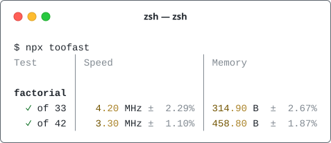
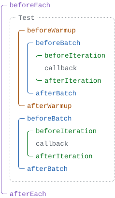

<p align="center">
  <a href="#readme"></a>
</p>

The Node.js performance testing tool with unit-test-like API.

- Runs each test in its own process.
- Prevents timer resolution from distorting test results.
- Runs batches of calls until the target margin of error is reached.
- Warms up tested functions.
- Measures memory allocation of each test.
- Supports TypeScript test files as is.
- Zero dependencies.

```shell
npm install toofast --save-dev
```

TooFast requires Node.js 22.18+.

🔰&ensp;[**Usage**](#usage)

🚀&ensp;[**Authoring tests**](#authoring-tests)

- [`test`](#test)
- [`measure`](#measure)
- [`describe`](#describe)
- [Lifecycle hooks](#lifecycle-hooks)
- [TypeScript support](#typescript-support)

⚙️&ensp;[**Configuration**](#configuration)

- [Config file](#config-file)
- [Test options](#test-options)
- [Inline options](#inline-options)
- [Command line arguments](#command-line-arguments)

🎯&ensp;[**How measurement works**](#how-measurement-works)

🍿&ensp;[**Why TooFast?**](#why-toofast)

# Usage

Let's write a performance test for a function that computes a factorial.

Create a file `factorial.perf.js`:

```ts
import { describe, test, measure } from 'toofast';

function factorial(x) {
  return x === 0 ? 1 : x * factorial(x - 1);
}

describe('factorial', () => {
  test('of 33', () => {
    measure(() => {
      factorial(33);
    });
  });

  test('of 42', () => {
    measure(() => {
      factorial(42);
    });
  });
});
```

Call `toofast` in the same directory with this file:

```shell
npx toofast
```

TooFast prints results of each test:

<br>

<p align="center"><picture>
  <source media="(prefers-color-scheme: dark)" srcset="./assets/screenshot-dark.svg" />
  <source media="(prefers-color-scheme: light)" srcset="./assets/screenshot-light.svg" />
  
</picture></p>

<br>

- `4.20 MHz` is how many times per second the function runs: 4.2 million calls per second.
- `314.90 B` is how many bytes a call allocates on the heap.
- `± 2.29%` is the margin of error of the value on its left at 95% confidence.

Values that weren't measured are shown as `n/a`, for example, the memory of a test with
[memory measurement](#config-maxbatchmemorysamplecount) turned off. The margin of error is shown as `n/a` if it's
unknown, for example, if a measure has run a single batch.

The process exits with code 1 if a test, a `describe` block, a hook or a test file throws, if a test process crashes, or
if no tests are found.

# Authoring tests

TooFast exports functions that declare tests and hooks in a test file.

## `test`

`test` declares a test. A test contains one or more [`measure`](#measure) calls:

```ts
import { test, measure } from 'toofast';

test('factorial of 33', () => {
  measure(() => {
    factorial(33);
  });
});
```

Each test runs in a separate process, so the results of a test aren't affected by optimizations and garbage left by
other tests.

The test callback can be async, for example, to load data that measures use:

```ts
import fs from 'node:fs';
import { test, measure } from 'toofast';

test('parse a large file', async () => {
  const text = await fs.promises.readFile('./large.json', 'utf8');

  measure(() => {
    JSON.parse(text);
  });
});
```

## `measure`

`measure` declares the code to measure, and must be called inside a test. Measures run one by one after the test
callback returns.

The measured callback must be synchronous: if it returns a promise, the measure fails.

If a test has several measures, the result of the test is the mean of their call durations and allocations, where each
measure has the same weight no matter how many batches it has run. The difference between measured callbacks doesn't add
to the margin of error:

```ts
test('factorial of 33 and 42', () => {
  measure(() => {
    factorial(33);
  });

  measure(() => {
    factorial(42);
  });
});
```

`measure` accepts [test options](#test-options) and [hooks](#lifecycle-hooks) that apply only to this measure:

```ts
test('sort', () => {
  let values = [];

  measure(
    {
      measureTimeout: 5_000,

      // Each call sorts a new copy of the array
      beforeIteration() {
        values = randomValues.slice();
      },
    },
    () => {
      values.sort((a, b) => a - b);
    }
  );
});
```

## `describe`

`describe` groups related tests. Groups can be nested:

```ts
import { describe, test, measure } from 'toofast';

describe('Math', () => {
  describe('factorial', () => {
    test('of 42', () => {
      measure(() => {
        factorial(42);
      });
    });
  });
});
```

Groups are printed as headings in the report. When tests are [filtered by name](#command-line-arguments), the name of a
test is prefixed with names of its groups, separated by dots: `Math.factorial.of 42`.

## Lifecycle hooks

Hooks run code at different phases of a test:

<p align="center"><picture>
  <source media="(prefers-color-scheme: dark)" srcset="./assets/hooks-dark.svg" />
  <source media="(prefers-color-scheme: light)" srcset="./assets/hooks-light.svg" />
  
</picture></p>

- `beforeEach` and `afterEach` run around each test. They can be registered in a test file or in a `describe` block, but
  not inside a test, since the test has already started by then.

- `beforeWarmup`, `afterWarmup`, `beforeBatch`, `afterBatch`, `beforeIteration` and `afterIteration` run around each
  measure. They can be registered in a test file, a `describe` block or a test, or passed as
  [options to `measure`](#measure).

A hook applies to all tests and measures in the file or block where it's registered, including nested blocks. Measures
run after the test callback returns, so hooks registered after a `measure` call still apply to it. Hooks can't be
registered while a measure runs, for example, inside the measured callback.

Before-hooks of outer blocks run before before-hooks of inner blocks. After-hooks run in reverse order: hooks of inner
blocks and hooks that were registered last run first. `afterEach` and `afterBatch` run even if the test or the measured
callback has thrown.

Hooks can be async. TooFast waits for a returned promise before it goes on.

```ts
import { beforeEach, beforeBatch, describe, test, measure } from 'toofast';

describe('cache', () => {
  beforeEach(() => {
    // Runs before each test in this block
  });

  test('get', () => {
    measure(() => {
      cache.get('key');
    });

    beforeBatch(() => {
      // Runs before each batch of the measure above
    });
  });
});
```

`beforeIteration` and `afterIteration` run around every call of the measured callback, so each timed loop has a single
call, and the overhead of the timer is added to the results. Prefer `beforeBatch` and `afterBatch` if they are enough.
For example, if each call needs a fresh object, `beforeBatch` can create enough objects for a batch, and
[`maxBatchIterationCount`](#config-maxbatchiterationcount) can limit the number of calls in a batch.

## TypeScript support

Node.js strips types from TypeScript files, so `*.perf.ts` and `*.perf.mts` test files run without any additional
configuration. Syntax that needs a transformation, such as `enum`, isn't supported.

# Configuration

## Config file

TooFast reads `toofast.json` from the current working directory if it exists.

```json
{
  "$schema": "./node_modules/toofast/config_schema.json",
  "testFilePatterns": ["**/*.perf.ts"],
  "testOptions": {
    "measureTimeout": 5000
  }
}
```

<dl>
<dt><a name="config-testfilepatterns"></a><code>testFilePatterns</code></dt>
<dd>

The array of glob patterns of test files, relative to the config file. Files in `node_modules` are never included.

Defaults to `["**/*.perf.{js,mjs,ts,mts}"]`.

</dd>
<dt><a name="config-setupfilepatterns"></a><code>setupFilePatterns</code></dt>
<dd>

The array of glob patterns of files that are imported before each test file, relative to the config file. Each test runs
in a separate process, so setup files are imported in each of them.

</dd>
<dt><a name="config-testoptions"></a><code>testOptions</code></dt>
<dd>

The default [test options](#test-options) of all tests.

</dd>
</dl>

## Test options

Test options control how measures run. Set them in the [config file](#config-testoptions), or pass them to
[`describe`, `test` or `measure`](#inline-options).

<dl>
<dt><a name="config-measuretimeout"></a><code>measureTimeout</code></dt>
<dd>

The maximum duration of a measure in milliseconds, not counting warmup. When it's reached, the measure stops even if
[`targetRme`](#config-targetrme) isn't reached yet.

Defaults to 10 000.

</dd>
<dt><a name="config-targetrme"></a><code>targetRme</code></dt>
<dd>

The relative margin of error at which the measure stops, between 0 and 1. For example, 0.05 stops the measure when the
mean call duration is known within ±5% at 95% confidence.

Defaults to 0.05.

</dd>
<dt><a name="config-minbatchcount"></a><code>minBatchCount</code></dt>
<dd>

The minimum number of batches before [`targetRme`](#config-targetrme) can stop the measure. A few batches may agree by
chance, for example, while the CPU is changing its frequency. [`measureTimeout`](#config-measuretimeout) still stops the
measure if it's reached first.

Defaults to 5.

</dd>
<dt><a name="config-maxwarmupbatchiterationcount"></a><code>maxWarmupBatchIterationCount</code></dt>
<dd>

The maximum number of calls during warmup. V8 optimizes a function after it has been called many times, so warmup keeps
slow unoptimized calls out of the results. Warmup is also limited by [`batchTimeout`](#config-batchtimeout) and
[`maxBatchIterationCount`](#config-maxbatchiterationcount).

Defaults to 10 000. Set to 0 to skip warmup.

</dd>
<dt><a name="config-maxbatchiterationcount"></a><code>maxBatchIterationCount</code></dt>
<dd>

The maximum number of calls in a batch, including untimed calls that measure memory and calibrate loops. Set it if
`beforeBatch` prepares data for a limited number of calls.

Unlimited by default.

</dd>
<dt><a name="config-batchtimeout"></a><code>batchTimeout</code></dt>
<dd>

The maximum duration of a batch in milliseconds. A batch always times at least one loop, even if that loop takes longer.

Defaults to 1 000.

</dd>
<dt><a name="config-batchpauseduration"></a><code>batchPauseDuration</code></dt>
<dd>

The pause after each batch in milliseconds. It gives the garbage collector time to run between batches instead of during
them.

Defaults to 200.

</dd>
<dt><a name="config-minloopduration"></a><code>minLoopDuration</code></dt>
<dd>

The minimum duration of a timed loop in milliseconds. A fast callback is called many times in a loop that is timed as a
whole, so the overhead and resolution of the timer don't distort results. Loops are shorter if
[`maxBatchIterationCount`](#config-maxbatchiterationcount) is too small, and have a single call if there are
`beforeIteration` or `afterIteration` hooks.

Defaults to 1.

</dd>
<dt><a name="config-maxbatchmemorysamplecount"></a><code>maxBatchMemorySampleCount</code></dt>
<dd>

The maximum number of memory samples in a batch. A memory sample is an extra call after a loop, which measures how many
bytes the callback allocates instead of how long it takes.

Defaults to 10. Set to 0 to skip measuring memory.

</dd>
</dl>

## Inline options

Pass [test options](#test-options) to [`describe`](#describe), [`test`](#test) or [`measure`](#measure) to override the
options from the config file. Options of a block apply to all blocks nested in it, and nested blocks can override them.

```ts
import { describe, test, measure } from 'toofast';

describe('factorial', { measureTimeout: 5_000 }, () => {
  test('of 33', { maxWarmupBatchIterationCount: 1_000 }, () => {
    measure({ targetRme: 0.01 }, () => {
      factorial(33);
    });
  });
});
```

## Command line arguments

<dl>
<dt><code>--config</code></dt>
<dd>

The path to a config file. Unlike the default `toofast.json`, this file must exist.

```shell
npx toofast --config toofast.ci.json
```

</dd>
<dt><code>...testNamePatterns</code></dt>
<dd>

Patterns of names of tests to run. A test name is prefixed with names of enclosing `describe` blocks, separated by dots.
`*` matches any characters, and matching is case-insensitive. If no tests match, the run fails.

```shell
npx toofast 'factorial.*'
```

</dd>
</dl>

# How measurement works

A measure first warms up the callback: it calls the callback one call at a time, so V8 can optimize it.

Then the measure runs batches with a [pause](#config-batchpauseduration) after each batch:

- A batch calls the callback in loops. A loop is timed as a whole with two
  [`performance.now()`](https://nodejs.org/api/perf_hooks.html#performancenow) calls, so the overhead of the timer is
  spread over many calls.

- In the first batch, loops get twice as long until a loop lasts at least [`minLoopDuration`](#config-minloopduration).
  Shorter loops are discarded.

- After a loop, an extra call measures how much the heap has grown during the call, using
  [`v8.getHeapStatistics()`](https://nodejs.org/api/v8.html#v8getheapstatistics). Samples where the garbage collector
  has shrunk the heap are discarded.

- Each batch adds its mean call duration to the results. The margin of error comes from how much batches differ, so it
  reflects noise such as changes of CPU frequency and garbage collection.

The measure stops when the margin of error of batches reaches [`targetRme`](#config-targetrme), but not before
[`minBatchCount`](#config-minbatchcount) batches, or when [`measureTimeout`](#config-measuretimeout) is reached.

# Why TooFast?

Most JavaScript benchmarking tools are libraries that run all benchmarks in one process for a fixed amount of time.
TooFast works like a test runner instead:

- **Each test runs in its own process.**<br>JIT optimizations, inline caches and garbage left by one test can't change
  the results of another, so the order of tests doesn't matter. Only `describe` blocks that contain the test are
  evaluated, so other tests don't add objects to the measured heap.

- **Fast functions are timed in loops.**<br>A loop of calls is timed as a whole, and is calibrated to last at least
  [`minLoopDuration`](#config-minloopduration). The overhead and resolution of the timer are a tiny part of each sample,
  even for functions that take a few nanoseconds.

- **Measures run until results are precise enough.**<br>A measure stops when batches agree within
  [`targetRme`](#config-targetrme), so stable functions finish quickly, and noisy ones get more batches.

- **Memory is measured along with speed.**<br>Each result shows how many bytes a call allocates, without extra Node.js
  flags.

- **Tests fit into a project like unit tests.**<br>`describe`, `test` and lifecycle hooks, a CLI that finds `*.perf.*`
  files, name filters, a config file with a JSON schema, TypeScript without a build step, and exit code 1 on failures
  for CI.

How TooFast compares to other tools:

|                           | TooFast          | Vitest bench     | tinybench  | mitata     | bench-node           | cronometro      |
| ------------------------- | ---------------- | ---------------- | ---------- | ---------- | -------------------- | --------------- |
| Isolation                 | Process per test | Process per file | None       | None       | Worker per benchmark | Worker per test |
| Timing of fast functions  | Loops            | Each call        | Each call  | Loops      | Loops                | Each call       |
| Stops when                | Precise enough   | Time is up       | Time is up | Time is up | Time is up           | Precise enough  |
| `describe` and `test` API | ✅               | ✅               | ❌         | ❌         | ❌                   | ❌              |
| CLI that finds test files | ✅               | ✅               | ❌         | ❌         | ❌                   | ❌              |
| Async functions           | ❌               | ✅               | ✅         | ✅         | ✅                   | ✅              |
| Memory usage              | ✅               | ❌               | ❌         | ✅         | ❌                   | ❌              |
| Runtimes                  | Node.js          | Node.js, browser | Multiple   | Multiple   | Node.js              | Node.js         |

<hr/>

<p align="center">:octocat: :heart:</p>
